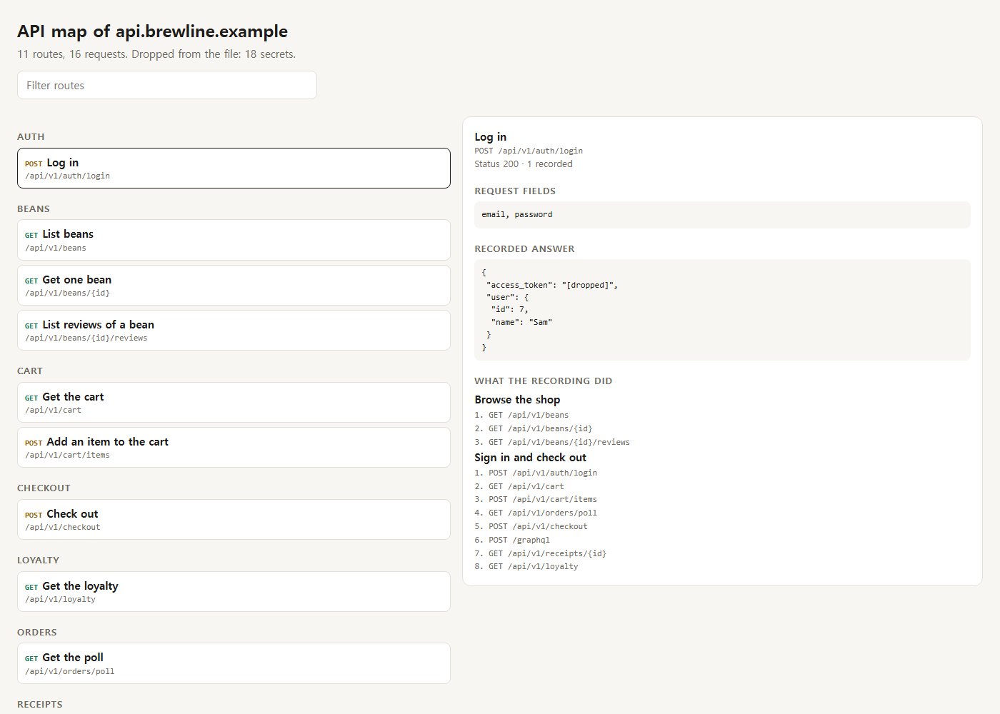
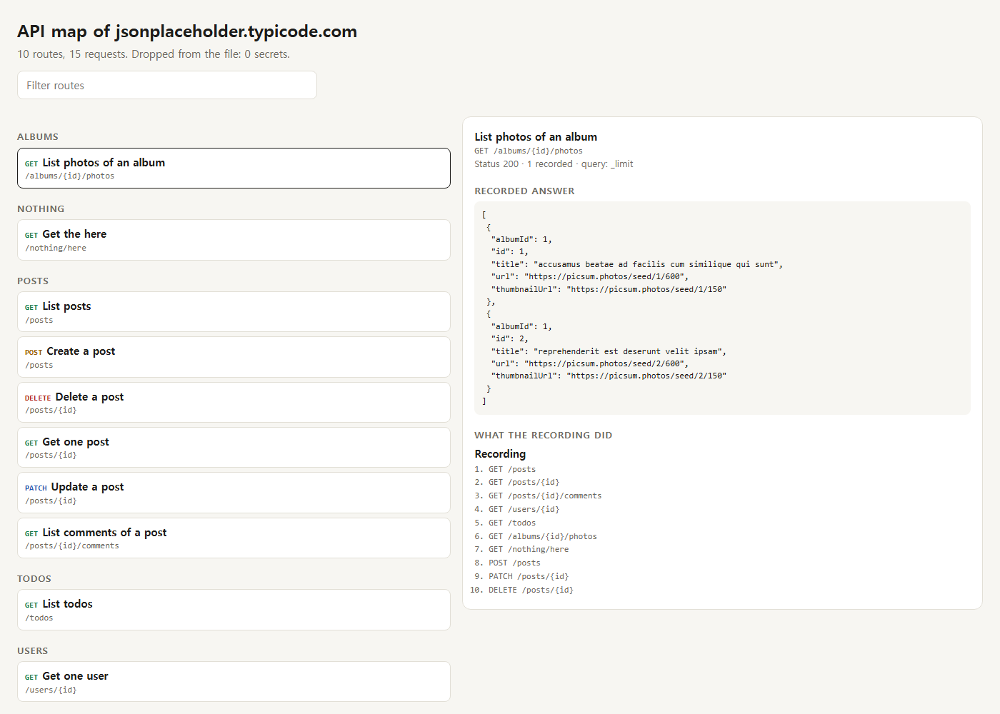

<div align="center">

# har2clone

**Turn a browser recording of any web app into an API map, OpenAPI spec, working mock backend and a rebuild check.**

Craft Anything showed that a recording is enough to stand in for a backend, and Floorplan showed that people read plain-English maps. This puts both in one Python file you can run today.

Works with **Claude Code** and **Codex**. No API key, no source code, no dependencies.

  



</div>

## Quick start

```bash
git clone https://github.com/Dodai0419/har2clone && cd har2clone
python har2clone.py --demo
```

Real output of the demo, on the bundled synthetic recording:

```text
11 routes from 16 requests on api.brewline.example
secrets dropped: 18 (16 headers, 1 query_values, 1 json_values)
skipped: 2 static
...
stand-in GET /api/v1/beans/2 -> 200 {"id": 2, "name": "Huila", "price": 16.0, "roast": "medium"}
ok    GET /api/v1/beans
ok    GET /api/v1/beans/{id}
...
check: 7/7 recorded reads answer the same way (writes are not sent)
```

Then use it on your own app:

```bash
python har2clone.py build site.har -o clone
python har2clone.py serve clone --port 8787
python har2clone.py check clone --against http://localhost:3000
```

To get `site.har`: open browser DevTools, Network tab, tick **Preserve log**, use the app, right click a request, **Save all as HAR**.

## Install in your agent

**Claude Code**

```bash
/plugin marketplace add Dodai0419/har2clone
/plugin install har2clone@har2clone
```

**Codex (ChatGPT)**

```bash
git clone https://github.com/Dodai0419/har2clone && cp -r har2clone/skills/* ~/.codex/skills/
```

Or copy `AGENTS.md` to your project root. Then tell your agent: *"Here is site.har. Rebuild this front end against a stand-in and prove it matches."*

## The problem

- **Rebuilding an app means guessing its API.** You own the old app, the source is lost or the vendor is gone, and nothing says what the front end expects.
- **Front-end work waits on a backend.** A mock needs hand-written fixtures that drift away from what the real server says.
- **A HAR file is unsafe and unreadable.** It holds your cookies and tokens, and it is 40 MB of JSON nobody can review or commit.

## The solution

| Idea | Fixes |
|------|-------|
| **Map in plain English** | Every route gets a name such as "List reviews of a bean", grouped by resource, with the order your session used them |
| **OpenAPI from real answers** | Request and response schemas are inferred from what was sent, with names and types only |
| **Stand-in backend on loopback** | Your front end talks to recorded answers over real HTTP, including error statuses and GraphQL operations |
| **Rebuild check** | `check` asks your rebuild every recorded read and compares status and JSON shape, then exits 1 on any difference |
| **Secrets dropped before anything is written** | Cookies, auth headers, token query values, secret JSON fields and known key formats never reach the output files |

## What you get

`har2clone build site.har -o clone` writes four files.

| File | For | Contents |
|---|---|---|
| `map.html` | People | One self-contained page: filter routes, click one to see its fields and recorded answer |
| `REBUILD.md` | Agents | Route table, the session in order, and how to work with the stand-in |
| `openapi.json` | Tools | OpenAPI 3.0.3 with inferred schemas, ready for Swagger UI or a client generator |
| `standin.json` | `serve` and `check` | Every recorded answer, with secrets removed |

See a real [REBUILD.md](docs/example-output/REBUILD.md).

## Gallery

### A real public API

Recorded from 15 live requests to [JSONPlaceholder](https://jsonplaceholder.typicode.com), a free fake REST API. har2clone found 10 routes and folded `/posts/1`, `/posts/2`, `/posts/3` into `/posts/{id}`.



```text
| What it does            | Route                      | Status | Query         |
| List photos of an album | GET /albums/{id}/photos    | 200    | _limit        |
| Get the here            | GET /nothing/here          | 404    | -             |
| List posts              | GET /posts                 | 200    | _limit        |
| Create a post           | POST /posts                | 201    | -             |
| Delete a post           | DELETE /posts/{id}         | 200    | -             |
| Get one post            | GET /posts/{id}            | 200    | -             |
| Update a post           | PATCH /posts/{id}          | 200    | -             |
| List comments of a post | GET /posts/{id}/comments   | 200    | -             |
| List todos              | GET /todos                 | 200    | _limit, userId|
| Get one user            | GET /users/{id}            | 200    | -             |
```

### What the app asked for that you never recorded

The stand-in never invents an answer. It says why it has none and what is closest.

```bash
curl http://127.0.0.1:8787/photos/1
```

```json
{
 "har2clone": "path_not_recorded",
 "path": "/photos/1",
 "nearest": ["GET /nothing/here", "GET /posts/{id}", "GET /users/{id}", "GET /albums/{id}/photos", "GET /posts"]
}
```

Every miss is listed at `/__har2clone/misses`, which is your to-do list for the next recording.

### A rebuild that drifted

`check` found this after a rebuild renamed a field and changed a type:

```text
ok    GET /api/v1/beans
FAIL  GET /api/v1/beans/{id}
      $.name: missing
      $.price: missing
      $.roast: missing
      $.id: expected integer, got string
check: 6/7 recorded reads answer the same way (writes are not sent)
```

### Repeated requests and GraphQL

A polled URL goes through its recorded answers in order and starts again, so a progress screen really progresses:

```text
GET /api/v1/orders/poll -> {"state": "queued"}
GET /api/v1/orders/poll -> {"state": "roasting"}
GET /api/v1/orders/poll -> {"state": "queued"}
```

GraphQL requests to one URL are told apart by operation name. An operation that was never recorded gets a clear 404, because another operation's data would be the wrong answer.

## What gets dropped

| Where | Rule |
|---|---|
| Response headers | Anything with cookie, auth, token, secret, password, credential, csrf, session, signature, api-key or a name ending in -key |
| Request headers and values | Never read into the output. Request bodies keep only field names and types |
| Query strings | Values of `token`, `key`, `password`, `sig`, `code`, `session` and similar names |
| JSON answers | Values of secret-named fields, and known key formats anywhere in a string |
| Text | `Bearer` and `Basic` credentials, `user:pass@` in URLs, known key formats |
| Scripts and pages | Known key formats only, so `this.token=t` stays working code |
| Binary bodies | Left out whole if they contain a secret |
| Your own values | `--hide VALUE` removes one everywhere, including URL-encoded and base64 spellings |

Ordinary words survive on purpose: `{"plan": "Basic Membership", "code": "EUR", "session": "morning"}` comes through unchanged.

**What it cannot know:** names, emails and order history in answers look like normal data, so they stay. Pass `--hide`, and read `standin.json` before you share it. The build prints this reminder too.

## Safety

- The stand-in binds to `127.0.0.1` only.
- It refuses requests from other sites by `Origin`, and rebound hostnames by `Host`, because recorded answers can be private. Local dev servers on any port get CORS.
- Replay is read-only. A recorded `POST` answers as recorded and later reads do not change.
- `check` refuses non-local targets and never sends writes, so it cannot hit production or change data.
- `map.html` shows recorded bodies as text only, and loads nothing from the network.

**Use it on software you own or are allowed to study.** It is not for copying someone else's product against its terms or for getting around sign-in or payment.

## Why this instead of the sources

| | [Craft Anything](https://github.com/storytold/craft-anything) | [Floorplan](https://github.com/haydenschmitty/floorplan) | har2clone |
|---|---|---|---|
| Input | Any app or site, driven by an agent | Your source code | One HAR file |
| Install | Desktop app or Rust build | Plugin, Node 18+ | Python file |
| API map in plain English | App maps | Yes, from code | Yes, from traffic |
| Works without source | Yes | No | Yes |
| Stand-in backend from a HAR | Yes | No | Yes |
| OpenAPI file | Not found in its docs | Not found in its docs | Yes |
| Compare a rebuild with the recording | Yes, wider than HTTP | No | HTTP status and JSON shape |
| Studies binaries, games and bundles | Yes | No | No |

Choose Craft Anything for the whole clean-room pipeline. Choose Floorplan when you have the code. Choose har2clone when all you have is a browser and you want an answer in a minute.

## Commands

```text
har2clone build HAR [-o clone] [--hide VALUE]... [--only-host HOST]... [--include-static]
har2clone serve [FOLDER] [--port 8787]
har2clone check [FOLDER] --against http://localhost:3000
har2clone --demo
```

Stand-in endpoints:

| Path | Returns |
|---|---|
| `/__har2clone/routes` | Every route with its name |
| `/__har2clone/misses` | Requests with no recorded answer, and why |
| Any response header `X-Har2clone-Route` | The recorded route that answered |

Exit codes: `0` success, `1` `check` found a difference, `2` bad input.

## Known limits

- It knows only what was recorded. A flow you did not click is not in the map.
- Names come from the method and path, so some read oddly (`GET /loyalty` is "Get the loyalty"). Agents should rewrite them with the answers in view.
- Word-like ids merge only with evidence: two values with the same text after them, or three last segments answering in the same shape. One recording of `/teams/red` stays literal.
- `check` compares one sample per route, reads only, and shape only, never values.
- WebSocket messages and server-sent event streams are not replayed.
- Routes on different hosts with the same path share one template. Use `--only-host` to split them.

## Benchmarks

Measured with `python bench/bench.py` on Windows 11, Python 3.11, best of 5, three runs on a busy machine.

| | Craft Anything stand-in | har2clone |
|---|---|---|
| Build, 5,000 requests | not measured | 340 to 1,030 ms (idle to busy machine) |
| Replay one HTTP answer | not measured | 2.7 to 4.8 ms |
| Lines of code | 2,206 Rust (`standin.rs`, `standin_tools.rs`, `serve.rs`, HAR parsing not counted) | 888 Python, also includes map, OpenAPI and check |
| Packages | 780 in `Cargo.lock` (whole app) | 0 |

Craft Anything was not run for this comparison: this machine has no Rust toolchain. Its behaviour was ported from reading its source and its stand-in test, and that test's recording and expected answers are in `tests/test_har2clone.py`. The bundled map screenshot uses a synthetic recording. The JSONPlaceholder gallery uses live answers saved to HAR by a script, not a browser.

## Run the tests

```bash
python -m unittest -q
```

## Inspired by

- [storytold/craft-anything](https://github.com/storytold/craft-anything): the stand-in design, secret rules, path templates, replay order and no-match reasons, ported to Python (see `NOTICE`).
- [haydenschmitty/floorplan](https://github.com/haydenschmitty/floorplan): plain-English names and a one-file map people can read.

## Roadmap

- [ ] Compare every sample in `check`, not one per route
- [ ] Replay server-sent event streams
- [ ] Merge several recordings into one clone

## License

MIT. See [LICENSE](LICENSE) and [NOTICE](NOTICE).
